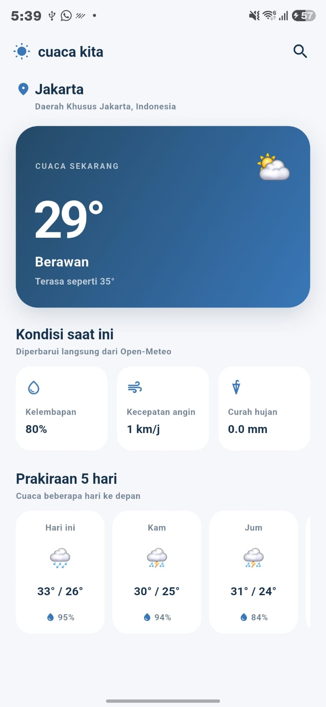
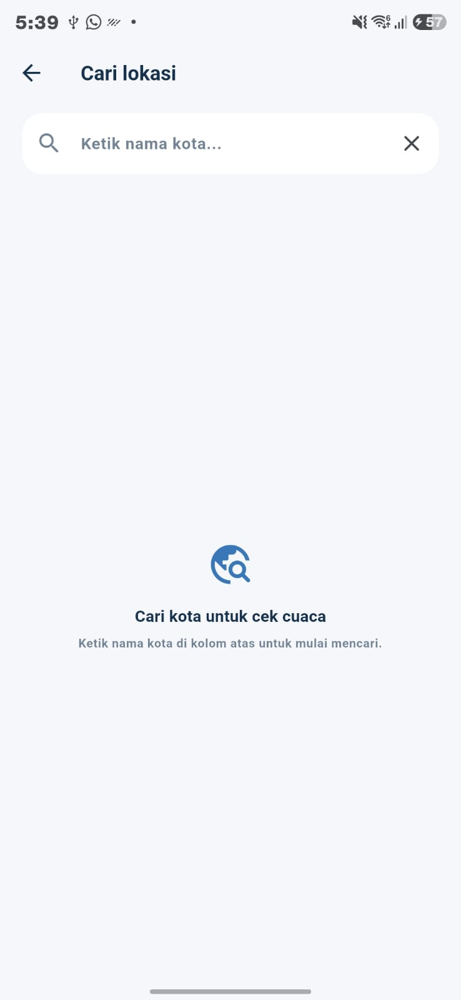

# Cuaca Kita

## Identitas Mahasiswa

- **Nama:** Jovita Fashya Islami
- **NIM:** H1D024125
- **Shift KRS:** Shift B
- **Shift Praktikum:** Shift I

Aplikasi cuaca Flutter berbahasa Indonesia. Data cuaca dan hasil pencarian kota
diambil langsung dari Open-Meteo; lokasi favorit disimpan di perangkat.

## Fitur

- Cuaca terkini: suhu, kondisi, suhu terasa, kelembapan, angin, dan curah hujan.
- Prakiraan harian lima hari, termasuk suhu minimum/maksimum dan peluang hujan.
- Pencarian kota melalui Geocoding API Open-Meteo.
- Lokasi favorit tersimpan dan tersedia kembali saat aplikasi dibuka.
- Tampilan loading, hasil kosong, dan error jaringan.
- Layout responsif dengan Material 3.

## Menjalankan aplikasi

Pastikan Flutter SDK tersedia, lalu jalankan:

```bash
flutter pub get
flutter run
```

Kota awal adalah Jakarta. Data cuaca tetap diminta dari API saat aplikasi
dijalankan; aplikasi memerlukan koneksi internet.

## Struktur dan MVVM

```text
lib/
  main.dart
  models/
    location.dart
    weather.dart
  services/
    favorites_storage.dart
    open_meteo_service.dart
  theme/
    app_theme.dart
  viewmodels/
    weather_view_model.dart
  views/
    home_screen.dart
    search_screen.dart
```

- **Model** (`models/`) memetakan respons JSON Open-Meteo menjadi model lokasi
  dan cuaca.
- **View** (`views/`) menampilkan layar cuaca dan pencarian, serta meneruskan
  interaksi pengguna ke ViewModel.
- **ViewModel** (`viewmodels/weather_view_model.dart`) mengelola state cuaca,
  pencarian, status loading/error, dan favorit. `ChangeNotifier` memperbarui
  tampilan saat state berubah.
- **Service** (`services/`) melakukan HTTP GET ke API dan menyimpan favorit
  dengan `shared_preferences`.

## API

- Geocoding: `https://geocoding-api.open-meteo.com/v1/search`
- Prakiraan: `https://api.open-meteo.com/v1/forecast`

Prakiraan meminta data cuaca terkini dan harian, menggunakan `timezone=auto`
serta lima hari prakiraan.

## Screenshot

Screenshot berikut diambil langsung dari aplikasi yang berjalan di HP.

### Cuaca / Home



### Pencarian lokasi



### Lokasi favorit


## Pengujian

```bash
flutter analyze
flutter test
```
